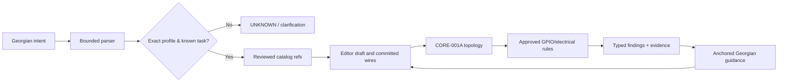

# RESEARCH G — Wokwi UX, ტექნიკური არქიტექტურა და INVENTOR EDU-ის დემოს სტრატეგია

**ფაილი:** `RESEARCH_G_WOKWI_UX_ARCHITECTURE_AND_DEMO_STRATEGY.md`  
**კვლევის თარიღი:** 2026-11-20 (Asia/Tbilisi)  
**სტატუსი:** დამოუკიდებელი კვლევა; **არა** არქიტექტურული ADR, განხორციელების ავტორიზაცია ან გაშვებული მომხმარებლის ექსპერიმენტი.  
**მეთოდი:** Wokwi-ის 2026 წლის 20 ნოემბერს ხელმისაწვდომი ოფიციალური დოკუმენტაცია, სამართლებრივი პირობები, ფასები და ღია რეპოზიტორიები; INVENTOR EDU-ის საჯარო `main`-ის კოდი/ანგარიშები; დამკვიდრებული სასწავლო კვლევები. წყაროების URL-ები მოცემულია ბოლოს.

## 0. გადაწყვეტილების შეჯამება

**გადაწყვეტილება: CONDITIONALLY PROCEED / NARROW.** შევქმნათ **Demo F — bounded Goal-to-Circuit**, არა Wokwi-ის კლონი: ქართულენოვანი მიზანი → კონტროლირებადი მოთხოვნები → კონკრეტული, ავტორიზებული კომპონენტის პროფილი → საკუთარი 2D რედაქტორი → არსებული terminal-to-net მოდელის დეტერმინისტული შეფასება → კონკრეტულ კონტაქტსა და წყაროს მიბმული ქართული ახსნა → გამოსწორების შემდეგ ხელახალი შემოწმება. **Fallback: Demo D — Component Knowledge Explorer + headless verifier**, თუ 2D ან GPIO/electrical rule gate დროულად ვერ შესრულდა. Fallback არ უნდა გასაღდეს ინტეგრირებულ wiring-პროდუქტად.

**რატომ ეს არჩევანი:** Wokwi უკვე ავითარებს MCP-ს, Agent Skills-ს, firmware regression-სა და ვირტუალურ აპარატურასთან აგენტის ინტერაქციას [S06–S09]. ამიტომ კონკურენტული ნიშა არ არის „AI აწყობს ESP32-ს“. გასატესტი ნიშაა **პროფილის სიზუსტე + წყაროზე მიბმული, შეზღუდული ელექტრული/პინის გადაწყვეტილება + სწავლების შედეგი**. ამ ნიშაში Wokwi-ის სრული არყოფნა **არ არის დამტკიცებული**; მხოლოდ შემოწმებული საჯარო დოკუმენტაციით არ დასტურდება ზუსტად იგივე end-to-end evidence/UNKNOWN კონტრაქტი.

**მთავარი შეზღუდვა:** პროექტის `main`-ზე არსებობს CORE-001A Python მოდელი და 11 PASS ტესტის შესრულების ანგარიში; `main`-ზე არ ჩანს 2D editor, CORE-001B/001C ან მიმდინარე აპლიკაცია. CORE-001A-R2 და DATA-001 მოცემულია handoff-ში, მაგრამ ამ კვლევაში არ არის დამოუკიდებლად მიღებული როგორც `main`-ის შესრულებული არტეფაქტები. ვეყრდნობით მხოლოდ იმას, რაც უშუალოდ შევამოწმეთ, ან ცალკე ვნიშნავთ `USER_REPORTED` [P01–P05].

**დამადასტურებელი ფუნქციური მინიმუმი:** საჭიროა არანაკლებ **ერთი დადასტურებული შეზღუდვის უარყოფითი შემთხვევა**, **შესწორების შემდეგ finding-ის რეალური გაქრობა**, და **UNKNOWN**; შერჩეული `docs/DEMO.md` კონტრაქტი დამატებით ითხოვს **GPIO** და **ელექტრული ძაბვის** ცალ-ცალკე სწორ finding-ს. სანამ მეორე არ არსებობს, დემო შეიძლება იყოს wiring-checker-ის პროტოტიპი, მაგრამ **არ** უნდა გამოცხადდეს ამ კონტრაქტის სრულად მიღებულ დემოდ.

## 1. აუდიტის სანდოობის პროტოკოლი

| მარკერი | ზუსტი მნიშვნელობა | გამოყენება ამ ანგარიშში |
|---|---|---|
| `DIRECTLY_TESTED` | ქმედება რეალურ ინტერაქტიულ UI-ში შესრულდა, შედეგი ჩაიწერა | **არც ერთი Wokwi user journey**; საიტზე ავტორიზებული ინტერაქტიული სესია არ ჩატარებულა |
| `DOCUMENTED_ONLY` | ოფიციალური დოკუმენტაცია/საჯარო რეპო ადასტურებს აღწერას | Wokwi-ის editor, CLI, API, ფასი, ნაწილები, OSS |
| `REPOSITORY_INSPECTED` | GitHub-ის მიმდინარე ფაილი/commit რეალურად წაკითხულია | INVENTOR EDU-ის main; Wokwi-ის რიგი OSS რეპო |
| `USER_REPORTED` | handoff-ში დასახელებული, მაგრამ დამოუკიდებლად არ შემოწმებული | CORE-001A-R2, DATA-001, Research E-ის პილოტი |
| `INFERRED` | არქიტექტურული/UX დასკვნა, არა ფაქტი | friction, differentiation, effort, ROI |
| `UNVERIFIED` | შემოწმებას მოკლებული ან დახურული საკითხი | Wokwi-ის შიდა engine, კონკრეტული Classroom შეთავაზება, არარსებობის მტკიცება |

**დოკუმენტური წყაროს შეზღუდვა:** საიტის HTML და Wokwi-ს საჯარო პროექტების ტექსტური გვერდები ხელმისაწვდომი იყო, მაგრამ mouse/key interaction, drag latency, responsive layout, accessibility, saving/recovery და მოქმედი მომხმარებლის ანგარიშის გამოცდილება არ გვიცდია. UX-ის შეფასებები არის **heuristic audit**, არა საველე observation. მოძიებული საჯარო სურათები ნებადართული არ არის Wokwi-ის დღევანდელი სრულყოფილი UX-ის ტესტის შემცვლელად.

**წინააღმდეგობრივი წყაროები:** Wokwi Docs-ის `LICENSE` ფაილი MIT-ია, თუმცა იგივე რეპოს README დოკუმენტურ ნამუშევარს CC BY 4.0-ს უწერს. პრაქტიკულად საჭიროა კონკრეტული ნაწილის license review; არ მოვახდინოთ მთელი ვებდოკუმენტაციის MIT-ით გამოცხადება [O04].

## 2. Wokwi-ის მიმდინარე პროდუქტის რუკა

| ფენა | რა არის დადასტურებული | სტატუსი | შედარებითი მნიშვნელობა |
|---|---|---|---|
| საწყისი პროექტები | Arduino, ESP32, STM32, Pi Pico, MicroPython და public project არჩევანი | `DOCUMENTED_ONLY` [S01,S03] | ფართო onboard-დაწყება |
| 2D diagram editor | ნაწილების დამატება, გადაადგილება, 90° როტაცია, wire, routing hints, ფერები, grid, keyboard shortcuts, undo/redo | `DOCUMENTED_ONLY` [S02] | ძლიერი ბაზისური UX |
| ფაილური პროექტი | `diagram.json` + კოდი/ბიბლიოთეკები + ოპციური serialMonitor | `DOCUMENTED_ONLY` [S04] | შესაძლო **ფორმატის** interoperability; არა ძრავის ლიცენზია |
| MCU ემულაცია | AVR, ESP32, STM32, RP2040/RP2350 მხარდაჭერა, გამოცალკევებული beta chips | `DOCUMENTED_ONLY` [S03] | სრულ emulator კონკურენციას არ აქვს აზრი |
| სენსორები/ეკრანები | HC-SR04, DHT22, OLED, ღილაკი, LED, A4988 და სხვ. სიმულაციური მოდელები | `DOCUMENTED_ONLY` [S03,S11–S16] | სინათლის/სიგნალის დემო მარტივია |
| debugging | Serial Monitor, Logic Analyzer/VCD, GDB/interactive debugger-ის აღწერილი ინტერფეისები | `DOCUMENTED_ONLY` [S17,S18] | ძლიერი firmware-სწავლება |
| Wokwi CI | CLI token, scenarios YAML, expect-pin/serial/screenshot, headless tests | `DOCUMENTED_ONLY` [S08,S09] | საკმარისია regression workflows-ისთვის |
| MCP + AI skills | ექსპერიმენტული MCP, CLI-based 4 skills, agent-driven testing | `DOCUMENTED_ONLY` [S06,S07] | **AI ტექნიკური ინტეგრაცია უკვე კონკურენტის მხარესაა** |
| Classroom | ინსტიტუციური teacher/student seats და ცალკე quotation | `DOCUMENTED_ONLY` [S10,S19] | განათლების ბაზარიც უკვე სამიზნეა |
| მტკიცებულებებზე დაფუძნებული voltage/ERC | საერთო, ოფიციალურად დადასტურებული engineering safety verifier ვერ ვიპოვეთ | `UNVERIFIED` | არ ნიშნავს, რომ ასეთი შიდა/მესამე მხარის სამუშაო არ არსებობს |

### სიმულაცია ≠ დამოუკიდებელი ვერიფიკაცია

Wokwi docs თავად აცხადებს, რომ ანალოგური სიმულაცია შეზღუდულია [S20]; რეზისტორის გვერდი აფრთხილებს შეზღუდულ analog circuit simulation-ზე [S12]; A4988-ის დოკუმენტაცია პირდაპირ ამბობს, რომ `VMOT` სიმულაციაში არ გამოიყენება [S16]. **არ შეიძლება** წარმატებული simulated LED ან HC-SR04 შედეგიდან იმ კონკრეტული რეალური მოდულის ელექტრული თავსებადობის დასკვნა.

## 3. სრული 18-ეტაპიანი UX journey — დოკუმენტური/ჰეურისტიკული აუდიტი

მოქმედებათა რაოდენობა დათვლილია მხოლოდ მაშინ, როცა დოკუმენტში კონკრეტულად არის განსაზღვრული; რეალური კლიკების რაოდენობა, დაყოვნებები და novice completion rate **არ გაზომილა**.

| # | მომხმარებლის ეტაპი | ოფიციალური საფუძველი / აღწერა | UX friction და INVENTOR-ის კონტრაქტი |
|---:|---|---|---|
| 1 | შესვლა | საიტზე project family CTA [S01] | არჩევანი ცნობადი; authenticated return flow უცნობია |
| 2 | ტიპის შერჩევა | Arduino/ESP32/STM32/Pico [S01] | დამწყებს შესაძლოა მიზანი იცოდეს, არა board class; INVENTOR-ში goal-ით დავიწყოთ |
| 3 | პროექტის შექმნა | Wokwi-ის templates/CLI `init` [S01,S18] | IDE/template knowledge სჭირდება; ჩვენი მიზნის parser მხოლოდ known task catalog-ს გაუშვებს |
| 4 | პირველი workspace | საჯარო project HTML-ზე კოდი და დიაგრამა; სრული responsive ტესტი არ ჩატარებულა | ლეიაუთის უპირატესობა **არ არის გაზომილი** |
| 5 | კომპონენტის მოძებნა | `+` ან `A` → part menu; ზოგი board მხოლოდ JSON-ით [S02] | novice-ს არ ეცოდინება component family; curated suggested parts |
| 6 | დამატება | menu selection, default `(0,0)`, drag [S02] | overlap/visibility რისკი; auto-fit და განლაგება |
| 7 | გადატანა/შებრუნება | drag/arrows, `R`, grid [S02] | physical net არ უნდა შეიცვალოს მხოლოდ გეომეტრიით |
| 8 | pin selection | hover-ით pin names [S04] | პატარა pin target, label ambiguity; zoom+terminal inspector |
| 9 | wire შექმნა | source pin click, target pin click [S02] | engineering semantic only after committed endpoint |
| 10 | არასწორი wire შეცვლა | wire select → delete/double-click; `Esc` cancel [S02] | undo+finding recomputation, no stale highlights |
| 11 | თვისებების რედაქტირება | `attrs`, part docs; UI-ის ყველა inspector ქცევა არ დადასტურდა [S04] | variant/mode change must invalidate stale evidence |
| 12 | firmware editor | code files და project tabs საჯარო მაგალითებში | ჩვენ 4კვირიან დემოში **არ ვქმნით** firmware IDE-ს |
| 13 | simulation start | documented Run/CLI simulation [S18] | INVENTOR-ს არ უნდა ჰქონდეს pretend Run/Simulation |
| 14 | შედეგი | serial, device state, logic analyzer [S17] | ჩვენი შედეგი არის rule finding, არა simulated real world |
| 15 | შეცდომის შემჩნევა | CLI lint, tests; UI safety overlay-ის უნივერსალურობა უცნობია [S04,S18] | tie finding to exact wire/net/terminal |
| 16 | დიაგნოსტიკა | debugger/GDB, docs hotkey `?` [S02,S17] | Georgian causal explanation + source locator |
| 17 | შენახვა/გაზიარება | public projects/free, unlisted on paid [S10] | in-demo local JSON save/reload; cloud accounts optional |
| 18 | ხელახალი გამოყენება | copy/paste parts+connections between projects [S02] | preserve versioned evidence and explicit compatibility of restored catalog |

**რისკების რანჟირება (ინფერენცია):** P0 — pin target semantics, incomplete wire, unknown variant; P1 — small-screen hit area, selection ambiguity, wire reroute, stale finding; P2 — advanced keyboard workflow. ცუდ UX-ზე არ უნდა აშენდეს დასკვნა ვერც დოკუმენტაციით და ვერც 1–2 screenshot-ით. საჭიროა 5–8 ბეტა-მომხმარებლის ცალკე გამეორებადი observation-ები.

## 4. 2D microinteraction inventory

| Interaction | Wokwi დღეს | ჩვენი მიზნობრივი სემანტიკა | ვალიდაცია |
|---|---|---|---|
| Pin activation | pin hover ასახელებს pin-ს; active highlight ვიზუალურად ვერ გადამოწმდა | hover/focus → canonical physical contact ID + display label; target eligibility | hit test + exact ID |
| Wire start/end | click pin → click მეორე pin; `Esc`/right click cancel [S02] | `DRAFT` არ შედის committed topology-ში; only completed endpoints saved | connectivity diff |
| Wire bends | routing-click და orthogonal mini-language [S02,S04] | bend point UI-only; reroute must not affect net IDs | topology invariant |
| Wire color | ავტომატური ground/5V/green, user overrides [S02] | color არის presentation, არასოდეს voltage proof | color-invariance |
| Wire delete | select+delete / double-click [S02] | remove conductor ID, recompute affected net | split oracle |
| Geometry | grid 2.54mm, zoom/pan hotkeys [S02] | screen coords separate; no geometry-controlled junction inference | move/rotate oracle |
| Multi-select | Shift, copy/paste including internal wires [S02] | deterministic new IDs, no accidental short | ID tests |
| Undo/redo | Ctrl+Z/Y documented [S02] | invert accepted operation, re-run verifier, preserve finding provenance | undo round-trip |
| Inspector | docs part properties; consistent UI panel not independently tested | stable side pane for identity, mode, evidence, unknowns | usability test |
| Code vs diagram | Wokwi connects execution with project files, CLI and debugging [S08,S17,S18] | no code editor in bounded demo; clearly badge “firmware not evaluated” | user comprehension |

**საკვანძო დიზაინის წესი:** UI ბიბლიოთეკაში გაწერილი visible pin-ის სახელი არ ნიშნავს მწარმოებლის exact physical terminal-თან იდენტურობას. `displayLabel` → `physicalTerminalKey` მეფინგი უნდა იყოს explicit, scoped და versioned. Wokwi Elements მხოლოდ visual presentation-ს იძლევა, არა wiring physics-ს [O03].

## 5. Wokwi-ის საგანმანათლებლო შესაძლებლობების აუდიტი

| დახმარება | Wokwi | INVENTOR target | პასუხისმგებლობის გამიჯვნა |
|---|---|---|---|
| A. Documentation help | pin reference, tutorials, `?` docs, examples: დადასტურებული [S02,S11–S16] | ლოკალიზებული explanation + evidence | კონკრეტული ფაქტი პირველწყაროდან |
| B. Code assistance | Wokwi Agent Skills / MCP აგენტებთან; Wokwi არ არის მხოლოდ code autocomplete [S06,S07] | მომავალში, არა DEMO_REQUIRED | LLM კოდს ქმნის, ვერ ქმნის ახალ physics truth-ს |
| C. Simulation feedback | serial, logic analyzer, GDB, automated scenario [S08,S17,S18] | ამ ეტაპზე არ ვეკონკურებით | simulated behavior bounded |
| D. Goal-aware guidance | იგივე ფორმით *ნატიური*, evidence-გეითიანი workflow **არ დამტკიცებულა**; აგენტის საშუალებით ნაწილობრივ შესაძლებელია [S06,S07] | user goal+versioned facts+topology+reason code+validated response | უნდა შემოწმდეს head-to-head Wokwi+AI-სთან |

Classroom teacher/student role და seat assignment დადასტურებულია [S19], მაგრამ progress-tracking dashboard-ის დეტალები ამ კვლევაში `UNVERIFIED`; არ მივაწეროთ Wokwi-ს არც არსებობა, არც არყოფნა. **Wokwi-ის ძლიერი მხარეა embedded-debugging ინფრასტრუქტურა**, არა მხოლოდ ვიზუალური სწავლება.

### სასწავლო დიზაინის სანდო საფუძველი

Hattie–Timperley (2007) განასხვავებენ task/process/self-regulation feedback-ს [L01]. Chi et al. (1989) აღნიშნავენ თვითახსნის როლს worked examples-თან [L02]; van Merriënboer et al. (2003) complex task guidance/scaffolding-ს [L03]; Kalyuga et al. (2003) — novice-სა და expert-ს შორის expertise-reversal-ს [L04]. აქედან მოდის **ჰიპოთეზა**, რომ კონკრეტული მიზეზიანი მინიშნება ამოცანის შესრულებას დაეხმარება; **არ გამომდინარეობს**, რომ ნებისმიერი popup ზრდის სწავლას. NN/g-ის established error prevention/recognition heuristics გამოიყენება მხოლოდ UX-დიზაინის არგუმენტად [L05].

**ექსპერიმენტი:** ორ ჯგუფს (A: მხოლოდ factual findings; B: იგივე findings + ქართული მიზეზი/შემდეგი ნაბიჯი) მივცეთ თანაბარი 3 wiring ამოცანა; წინასწარ ვრანდომიზოთ თანმიმდევრობა. Outcome: critical wiring errors, time-to-correct, help requests, delayed transfer task (შეცვლილ pin-ზე), mental effort 1–7; B უნდა აუმჯობესებდეს delayed transfer-ს და არ ზრდიდეს ზედმეტ prompting-ს. საწყისი მცირე ნიმუში 12–20 მონაწილე არის **UX pilot, არა ეფექტიანობის სტატისტიკური დადასტურება**. Teacher/buyer willingness to pay ცალკე იზომება.

## 6. `diagram.json`: ტექნიკური საზღვრები

ფორმატი შეიცავს `version:1`, `author`, `editor`, `parts`, `connections`, optional `serialMonitor` [S04]. Part fields: `id`, `type`, `left`, `top`, `attrs`, `rotate`, `hide`. Connection 4-ელემენტიანი მასივი: `sourcePart:pin`, `targetPart:pin`, `color`, `routingInstructions`. Orthogonal route grammar: `vNN`, `hNN`, `*`. `wokwi-cli lint` ამოწმებს common JSON/connection შეცდომებს — ეს **არ უდრის** სრულ voltage/safety verifier-ს [S04,S18].

```json
{
  "version": 1,
  "author": "example",
  "editor": "wokwi",
  "parts": [
    {"id":"led1","type":"wokwi-led","left":120,"top":30,"attrs":{"color":"red"}}
  ],
  "connections": [["led1:A","esp:18","green",["v10","*"]]]
}
```

**ეს არის ფორმატის ილუსტრაცია და არა runnable Wokwi პროექტი:** `esp` example-ში არაა განსაზღვრული; ჩვენ მიერ გაშვებული/ვალიდირებული Wokwi ფაილი არ არის.

| შრე | ფორმატი შეიცავს? | მოქმედება importer-ში |
|---|---|---|
| simulator part ID/type | დიახ | მხოლოდ source-instance identity |
| pin label და logical connection pair | დიახ | map-to-canonical მხოლოდ reviewed adapter-ით |
| visual position/route/color | დიახ | preserve optional view, not engineering truth |
| exact manufacturer MPN / board revision | **არ არის გარანტირებული** | require external profile selection; ambiguous → UNKNOWN |
| physical contact/pad ↔ silicon GPIO evidence | **არ არის guarantee** | explicit evidence mapping required |
| official voltage max, direction, mode | **არ არის ზოგადი semantic schema** | manufacturer evidence required |
| source document, locator, review state | **არ არის general standard field** | independent provenance records |
| firmware code/state | სხვა project files/CLI | v1 **not evaluated** |
| constraints UNKNOWN / conflict | **არ არის general source-backed rule model** | our verifier handles separately |

**იმპორტის წესი:** Wokwi project reader may parse a **user-supplied, legally eligible** `diagram.json`, but `wokwi-esp32-devkit-v1` არ უნდა ავურიოთ `board-esp32-devkit-c-v4`-ში; უცნობი pin aliases არ უნდა მოვიფიქროთ. საჯარო project-ის URL არ არის პროექტის საავტორო უფლებების blanket license.

## 7. Wokwi component-reference მატრიცა

ზედმიწევნით **Wokwi part types**-ზეა საუბარი, არა რომელიმე real OEM/MPN-ის დამტკიცებულ სპეციფიკაციებზე.

| Family/type | pinout / role | attrs/control/sim behavior | მთავარი engineering gap | წყარო |
|---|---|---|---|---|
| `board-esp32-devkit-c-v4` | Wokwi part identifier; ზუსტი რეალური variant ცალკე უნდა აირჩეს | firmware virtual MCU | exact assembly/revision, limits/evidence per board | [S04,H01] |
| `wokwi-hc-sr04` | VCC 5V, TRIG, ECHO, GND | `distance` default 400 cm; trigger/pulse behavior | არა generic OEM proof; ECHO electrical high-voltage & actual operating condition ცალკე | [S11] |
| `wokwi-resistor` | 1,2 | `value` default 1000Ω; basic pull-up/down modeling | wattage/tolerance/temperature/model absent | [S12] |
| `wokwi-led` | A,C | color, gamma, visual brightness | actual forward voltage/current/series-resistor design not certified | [S13] |
| `wokwi-pushbutton` | 1.l/1.r და 2.l/2.r | momentary switching, bounce, shortcut | package wiring is internal; contact ratings/oem unprovided | [S14] |
| `board-ssd1306` | GND, VCC, SCL, SDA | `i2cAddress` default 0x3c | generic OLED breakout voltage/level details differ | [S15] |
| `wokwi-a4988` | ENABLE, STEP, DIR, VMOT და სხვ. | stepper/microstep behavior | VMOT **not used in simulation**; motor driver safety cannot be inferred | [S16] |

**შესანიშნავი ტესტი კონკურენტულ საზღვარზე:** Wokwi-ის HC-SR04 virtual module შეიძლება ამუშავდეს ისე, რომ რეალური ESP32 GPIO-ის შესაბამისობა ცალკე დაამტკიცებელი დარჩეს. ჩვენი სისტემა ასეთ შემთხვევაში აჩვენებს `GPIO_DIRECTION_PASS`-ს (თუ უფლება/მეფინგი ცნობილია), **მხოლოდ** ელექტრული ძაბვის rule-ის მიღების შემდეგ ცალკე `PASS/FAIL/UNKNOWN`-ს, არასოდეს ერთ მთლიან მწვანე „safe“ მდგომარეობას.

## 8. Custom Chips API და executable data

Wokwi Custom Chips არის **beta** [S05]. `*.chip.json` აღწერს `name`, `author`, `pins`, optional `controls`/`display`; optional empty-string pin slots; `controls`-ში input slider/values. C (ან WASM-ზე კომპილირებადი სხვა ენა) განსაზღვრავს `chip_init`-ს, user state-ს, pin watchers/timers, UART/I2C/SPI callbacks, graphical displays; debug `printf` ჩანს Chips Console-ში [S05,S21–S25].

| API | რეალური ფუნქცია | დოკუმენტირებული შეზღუდვა / რისკი |
|---|---|---|
| JSON definition | UI pin list + control/display | **არ აქვს** manufacturer limits/mode evidence-ის სავალდებულო schema |
| GPIO | `pin_init`, `pin_mode`, `pin_write`, watch | runtime API **simulation logic**-ს მართავს, არა datasheet compliance-ს [S21] |
| Analog | `pin_adc_read`, `pin_dac_write` | very limited analog; docs-ში virtual ADC ref 5V regardless of MCU [S20] |
| Time | chip timer/watch | event-time semantics, not physical time-precision assurance [S05] |
| UART | RX/TX callback, baud | frame/peripheral simulation only [S24] |
| I2C | SDA/SCL, address, connect/read/write callbacks | protocol interface, electrical pull-up verification არა [S22] |
| SPI | mode, MOSI/MISO/SCK, completion callback | CS/SS pin not native to SPI API; user manages watch [S23] |
| Chips Console / Logic Analyzer | debug print, digital events/VCD | trace may validate modeled digital behavior, not wiring safety [S05,S17] |

**არ ავირჩიოთ Wokwi Custom Chips API engineering-facts database-დ.** Custom-chip simulator behavior და იმავე რეალური მოწყობილობის absolute maximum ratings დამოუკიდებელი მასალაა. Wokwi-ის WASM მოდელები არ გადავიტანოთ საკუთარ პროდუქტში ავტორის explicit license გარეშე.

## 9. „სიმულაცია რისი მტკიცებულებაა“ მატრიცა

| სცენარი | Wokwi simulation-დან დასაშვები დასკვნა | აკრძალული დასკვნა |
|---|---|---|
| პროგრამა serial output-ს ბეჭდავს | firmware ამ მოდელირებულ გარემოში აწარმოებს ამ output-ს | რეალური HW სწორად კვებავს სენსორს |
| LED ენთება | logic simulation-მა LED state შეცვალა | LED current, resistor wattage უსაფრთხოა |
| HC-SR04 ზომავს `distance` | სიმულატორის მოდელში timing protocol მუშაობს | კონკრეტული OEM Echo voltage compatible with ESP32 |
| I2C LCD აჩვენებს ტექსტს | ემულირებული I2C transaction/renderer მუშაობს | რეალური pull-up, bus capacitance, level shifting სწორია |
| A4988 stepper ტრიალებს | digital stepping model reacts | VMOT/current/thermal limits შესრულებულია |
| GPIO signal VCD | digital waveform exists in simulator | physical slew/noise/EMC ტესტი გავლილია |
| `wokwi-cli lint` PASS | დოკუმენტირებული structural errors ვერ იპოვა | ყველა schema/fact/electrical rule PASS |
| ჩვენი GPIO checker PASS | კონკრეტულ source-backed GPIO capability rule-ს აკმაყოფილებს | მთლიანი მოწყობილობა safe / simulated |

**რეკომენდაცია:** ნებისმიერი result card შეიცავდეს `Checked: GPIO direction`, `Not checked: electrical levels, timing, firmware, thermal, wiring on physical board` და წყაროს ვერსიას.

## 10. Wokwi OSS & license register — რეალურად გადასატანი კოდი

GitHub repository HEAD-ები შემოწმებულია 2026-11-20; package version — იმ დღეს `main/package.json`, არა გარანტირებული npm release. OSS rights ეხება **კონკრეტულ რეპოს კოდს**, არა მთლიან hosted simulator-ს.

| რეპო / checked HEAD | ვერსია / ფუნქცია / API | ლიცენზია | კომერციული გამოყენება | გადაწყვეტილება |
|---|---|---|---|---|
| `wokwi/wokwi-elements` — `5178c0c` [O03] | `@wokwi/elements` 1.9.2, Lit Web Components; render-only SVG-like components | MIT, transitive `lit` inspect | MIT permits use with notices; assets/dependency provenance audit remains | **POTENTIAL DEMO UI SPIKE**: reuse renderers only if visual uniqueness and source review pass; does not include editor or physics |
| `wokwi/avr8js` — `bee6f0a` [O01] | `avr8js` 0.21.1; TypeScript AVR CPU core; npm API/build/test | MIT | yes under license | **DEFER**; irrelevant to ESP32 checker; no Wokwi simulator wrapper |
| `wokwi/rp2040js` — `cab5fae` [O02] | `rp2040js` 1.4.2; RP2040 core, GDB TCP export | MIT | yes under license | **DEFER**; MCU emulation not demo promise |
| `wokwi/wokwi-docs` — `291be17` [O04] | Docusaurus source/documentation | `LICENSE` MIT, README claims **CC BY 4.0** work | exact-file rights/attribution need reconciliation | **REFERENCE ONLY**, do not bulk copy docs/media |
| `wokwi/skills` — `9088be3` [O05] | Agent Skill Markdown for CLI: heap/LVGL/debug/build | MIT | source files generally reusable under notices | **REFERENCE/DEFER**; executes proprietary Wokwi CLI/token, not independent solver |
| Wokwi hosted service / closed CLI engine [S09,S19] | online editor, ESP32 engine, CI, MCP | proprietary service Terms | licensing/subscription; no embedded engine right inferred | **REJECT AS MVP CORE** absent written agreement |

**Technical integration load:** Wokwi Elements-ს აქვს browser/TS/Lit dependency და components-ის ჩვენება; Inventor-ის Pydantic backend-თან დასაკავშირებლად საჭიროა საკუთარი connector hit-map, event model, wire router, accessible focus/hover, lifecycle და finding overlay. ეს არის **მნიშვნელოვანი frontend სამუშაო**, არა install-and-done. `avr8js`/`rp2040js` არ უმატებს არსებული ESP32 GPIO/voltage-verifier-ს შემოწმების სიზუსტეს. MIT არ ნიშნავს არტეფაქტის სახელის/ბრენდის ლოგოს თავისუფლად გამოყენების გარანტიას.

### Wokwi-ის გამოყენების უფლებების ხუთი განსხვავებული კლასი

1. **Hosted simulator use:** მხოლოდ შესაბამისი account/license/Terms; commercial embedding — დაუდასტურებელია.
2. **ნამდვილი OSS source reuse:** კონკრეტული repo + LICENSE + dependency/asset audit + retained notices.
3. **Public JSON format study:** documented syntax შეიძლება შევისწავლოთ და საკუთარი parser დავწეროთ; source content license ცალკე.
4. **სხვისი საჯარო projects:** default *არანაირი* blanket reuse; author/license/consent ცალკე.
5. **დამოუკიდებელი semantics/UI:** generic interaction ideas (pin-to-pin, undo, orthogonal path) თავისუფლად შეიქმნას სხვა დიზაინით; source-specific visual assets და trademarks არ გადავაკოპიროთ.

### Pricing, commercial and lock-in

Wokwi pricing-ის ხელმისაწვდომი snapshot: **Community €0/mo** open-source/public projects; **Hobby €5.6/mo**, **Hobby+ €8.1/mo**, **Pro €20/seat/mo** displayed with annual-billing toggle; features/minutes differ; **Classroom quote-only** [S10]. ეს რიცხვები **არ არის** Inventor-ის integration quote და შეიძლება გადასახადები/ბილინგის წესები დამატებით იყოს. CLI და MCP საჭიროებს `WOKWI_CLI_TOKEN`-ს [S06,S09]. Terms აშკარად ზღუდავს ჩვეულებრივ წვდომას personal noncommercial scope-ით და commercial access-ისთვის ცალკე პირობებს ითვალისწინებს [S19]. Pro plan-ის ფასი არ ნიშნავს ავტომატურად white-label/embed/API-resell ლიცენზიას. Vendor lock-in: simulator semantics, token, proprietary CLI, pricing/minute caps, compatibility changes. **მიღება: no proprietary Wokwi production dependency**.

## 11. INVENTOR EDU-ის მიმდინარე მდგომარეობა — დამოუკიდებელი audit snapshot

**Observed GitHub `main` HEAD:** `b1db3e947d04508ca22d4ba55e3172616620bad2`, committed 2026-11-20 13:05:41Z [P01]. `README.md`-ის starter wording ნაწილობრივ მოძველებულია იმავე commit-ში არსებულ კოდთან შედარებით; უფრო მაღალი წონა მიენიჭა ფაილის რეალურ არსებობას + execution report-ს, არა README-ის ზოგად აღწერას.

| Capability | დადასტურება | კლასიფიკაცია |
|---|---|---|
| `inventor_edu/models.py`, `core.py`, `tests/test_core001a.py` | source exists on `main` [P02,P03] | `REPOSITORY_INSPECTED` |
| terminal-to-net, immutable Pydantic, canonical SHA-256, edited topology | CORE-001A execution report: 11 tests PASS, test log excerpt [P03] | **REPORTED PASS IN REPOSITORY**; ახალი დამოუკიდებელი local rerun არ ჩატარებულა |
| manufacturer evidence records and scoped claim admission | source models + report [P02,P03] | `REPOSITORY_INSPECTED`; application completeness not proven |
| CORE-001A-R2 / signal evidence catalog 1.1 | handoff ამბობს completed; `main`-ის visible model is v1.0 | `USER_REPORTED`, **not confirmed on audited main** |
| LibrePCB CC0 import DATA-001 pilot | handoff ამბობს successful generic resistor structural import | `USER_REPORTED`; MPN/electrical data explicitly unverified |
| CORE-001B GPIO verifier | Research B exists; implementing code on main not found | `NOT_CONFIRMED` |
| CORE-001C voltage check | research exists, implementation not found | `NOT_CONFIRMED` |
| 2D interactive editor & app frontend | `main` tree-ში არ ჩანს | `NOT_CONFIRMED` (not proof no other branch/local work) |
| Research E | handoff mentions; current `main` tree-ში არ ჩანს | `USER_REPORTED` |

**ამოცანის scope:** არ შემოგვაქვს universal ontology, არ ვეხებით canonical `DeviceIdentity`, `TerminalDefinition`, `SignalMapping`, `EvidenceClaim` ან conductor/net contract-ს UX-ის გასამარტივებლად. თუ intake/read adapter-მა ახალი ველი მოითხოვა, საჭიროა მონაცემით დადასტურებული missing-case და ცალკე არქიტექტურული გადაწყვეტილება.

## 12. Natural language → engineering intent: A/B/C შედარება

| მიდგომა | სარგებელი | მარცხის ტიპი | cost/privacy/GE localization | დასკვნა |
|---|---|---|---|---|
| A: LLM → free text advice | conversational UX მარტივი | plausible MPN/pin/limit hallucination; no replayable predicate | variable token cost, prompt privacy | **REJECT as engineering authority** |
| B: LLM → typed requirements → deterministic verifier | phrasing flexible, typed validation, unknown field detection | LLM still misparses user intent; must confirm high-impact ambiguities | API cost/caps; Georgian prompt tests needed | **8-week optional path** |
| C: rule/template parser → known catalog → verifier | minimal cost, deterministic/replayable, offline | narrow language coverage, paraphrase sensitivity | cheap; curated Georgian synonym set | **4-week default** |

**მინიმალური requirement candidate — მხოლოდ edge-level use-case record, არა canonical model-ის ჩანაცვლება:**

```json
{
  "intent_schema_version": "demo-0.1",
  "goal_id": "distance_warning_led",
  "locale": "ka-GE",
  "source_text": "თუ დაბრკოლება 30 სმ-ზე ახლოსაა, აინთოს LED",
  "expected_outcome": "threshold_alarm",
  "board_profile_ref": "SELECT_EXACT_PROFILE",
  "sensor_profile_ref": "SELECT_EXACT_PROFILE",
  "requires": [{"kind":"digital_input","source":"sensor.echo"},
               {"kind":"digital_output","target":"led.drive"}],
  "parameters": [{"name":"threshold","value":30,"unit":"cm"}],
  "unknowns": ["sensor operating mode", "LED electrical current limit"],
  "parser_method": "bounded_template",
  "acceptance_scope": "wiring only; firmware behavior not verified"
}
```

ეს ჩანაწერი **კვლევითი კანდიდატია**, არ არის მიმდინარე code/schema, არც production requirement grammar. სენსორის signal field-ები საჭიროა canonical evidence mapping-ით გადასამოწმებლად. `30 cm` არ წარმოადგენს იმპლემენტირებულ firmware threshold-ს. Flow: normalization → goal/template match → missing-constraint extraction → schema validation → source-approved component lookup → user confirmation of profile → canonical circuit snapshot → deterministic checks → explicit accepted/unsupported flags. LLM-ს შეუძლია **მხოლოდ** parser proposal-ის მიცემა; არც MPN, არც numeric voltage, არც `PASS` ვერ შექმნას.

## 13. Real-time contextual guidance-ის კონტრაქტი

**მექანიზმი:** accepted edit event → new canonical snapshot digest → applicable rules → typed findings → evidence joins → versioned explanation template → anchored overlay. UI-ს **არა აქვს უფლება** HTML-click-ზე პირდაპირ გასცეს engineering PASS/FAIL. UI only renders engine result.

| ველი | დანიშნულება |
|---|---|
| `finding_id` | deterministic stable identity per rule + subject + snapshot |
| `rule_id`/`rule_version` | ზუსტი verifier/logic |
| `subject_ref` | physical terminal, conductor, net, component instance |
| `status` | `PASS / FAIL / UNKNOWN / NOT_APPLICABLE` — mutually scoped |
| `reason_code` | stable machine-readable explanation lookup |
| `evidence_claim_ids` | approved source claims, precise locator |
| `assumptions` | source variant, operating conditions, mode, scope |
| `explanation_key` + `locale` | curated Georgian UI text template, not raw LLM verdict |
| `snapshot_digest` | discard stale results after edits |
| `unsupported_checks` | show what was not examined |

ეს არის output/UX-ის **შეთავაზებული adapter contract**, არა CORE-001A persistent schema-ის ცვლილება. Existing finding structure თუ უკვე განსაზღვრულია CORE-001B/C-ში, უნდა მოვარგოთ adapter-ით და არა ახალი duplicated domain object-ით.

### UI reaction policy

- **FAIL:** dotted/red anchored wire/terminal (ფერი მარტო არა — icon/text); inspector-ში ფაქტი, მიზეზი, repair option; არა modal.
- **UNKNOWN:** neutral/amber `ვერ დადასტურდა`; არ მოხდეს hidden automatic green fallback.
- **PASS:** label „GPIO output წესს აკმაყოფილებს“, **არა** „უსაფრთხოა“.
- **NOT_APPLICABLE:** display only on request/provenance section.
- **Draft wire:** muted incomplete indicator; არ ამოქმედდეს verifier სანამ terminal-to-terminal connection committed არ არის.
- **Stale revision:** invalidate previously approved fact, show re-review pending.
- **Hints:** show maximum one primary actionable hint in guided mode, collapse passive diagnostics; expert mode shows findings list and evidence, no forced pop-up.

**Explainability oracle:** independent reviewer gets identical snapshot/rule/evidence and reproduces reason, subject location and classification without reading generated explanation; explanation text may not assert a stronger result than engine. Misleading pass language counts as FAIL.

## 14. მონაცემთა იდენტობის შრეები — scope, არა ახალი ontology

| ცნება | ამ პროექტში რაც გვაქვს/რას ვამოწმებთ | საჭირო გამიჯვნა |
|---|---|---|
| Component family | generic resistor/HC-SR04 family | family ≠ purchasable MPN |
| Manufacturer / exact MPN | DeviceIdentity/SourceDocument-ის scope | retailer product listing ≠ OEM claim |
| Board assembly / revision | existing DeviceIdentity | Wokwi board type ≠ Espressif actual physical board |
| Package/pad | LibrePCB mapping pilot user-reported | schematic pin ≠ package pad ≠ header contact |
| Physical terminal/contact | CORE-001A verified scope | terminal key is verifier entity |
| Logical signal / GPIO/peripheral | SignalMapping; R2 claim still to be audited | avoid label-to-GPIO guesses |
| Operating mode/condition | EvidenceClaim condition | recommendation ≠ absolute maximum |
| Electrical constraint | CORE-001C future rule | missing condition → UNKNOWN |
| Simulated behavior | Wokwi custom-chip/parts modeling | does not become manufacturer evidence |
| Evidence + review state | source/reviewer data in core | admission rule; unsupported → blocked |
| Visual representation | future own UI / optional OSS render | geometry separate from topology |

## 15. Data source comparison matrix

| წყარო | ფორმატი/CLI | რაც შეიძლება მივიღოთ | არსებითი gap | ლიცენზია/დარწმუნება | იმპორტი/demo |
|---|---|---|---|---|---|
| Wokwi reference [S11–S16] | HTML docs | part pin labels, attrs, modeled behavior | real MPN/revision/current limits | Docs CC BY/MIT ambiguity; facts verify separately | reference only, **medium** demo context |
| Wokwi `diagram.json` [S04] | JSON / user export | simulator parts/connections/view | exact source facts, electrical rule provenance | file authorship separate | medium, interoperability **defer** |
| Wokwi Chip JSON [S05] | JSON + WASM | pins, controls, simulated I/O | actual silicon/physical ratings | user chip author/license needed | low, **defer** |
| LibrePCB official libraries [D01] | LibrePCB structured library files/Git | symbol/component/device/package/pad relation | guaranteed precise MPN/electrical limits | **official CC0**, record origin/commit | **high structural intake**; build on DATA-001 |
| KiCad symbols/footprints [D02] | S-expressions/Git | symbols, pins, footprints | exact semantic revision/physical device match | CC BY-SA 4.0 with output exception; compliance review | medium, optional |
| ESP-IDF [H02] | C headers/docs/SoC metadata | GPIO/peripheral constraints | board header mapping, sensor limits | Espressif code/file-specific licenses need review | **high** GPIO source corroboration |
| Manufacturer datasheets [H01,H03] | HTML/PDF, drawings | authoritative voltage, modes, limits, conditions | extraction & distribution rights, revision tracking | manufacturer evidence, usually link-only until rights checked | **critical/manual** |
| Vendor part-number catalogs [H03] | SKU/Product API/HTML | orderable SKU, listing identity | manufacturer guarantee, batch revision | terms/API permission per provider | identity cross-check only |
| Zephyr Devicetree [D03] | YAML bindings + DTS, C/build | board/peripheral wiring descriptors, compatible | electrical limits and physical exactness not guaranteed | Apache-2.0 source files as applicable | future board coverage |
| CMSIS-SVD/Pack [D04] | XML/SVD/PDSC | registers, peripherals, MCU capabilities | pinout/board safety not universal; ARM-oriented | specification permissive; **per-pack contents must review** | **low** for ESP32 first fixture |

**Repeatability:** each admitted source pins Git commit/asset digest, relevant target identity, source URL, publisher, accessed time, edition and reviewer decision. Dynamic vendor URLs aren't trusted as fixed content. **No mass PDF scraping** in MVP. For raw datasheets store download hash internally *only when access/retention permitted*; the user-facing product may keep source link + locator/short factual claim.

## 16. Evidence ingestion pipeline — executable control table

| Stage | Input → output | automated primitive | failure / human role / persistence |
|---|---|---|---|
| 1. Discovery | requested family/part → source candidate | registry search, manual link, git fetch | cannot identify authority → research queue; source URL log |
| 2. Legal eligibility | repo/file/website → rights state | SPDX/license file/terms parser + manifest | unknown license → link-only; lawyer/owner check if distribution |
| 3. Exact identity | SKU/MPN/board revision → unique scope | normalized exact comparison | aliases/OEM ambiguity → `UNKNOWN`; reviewer approval |
| 4. Structural extraction | LibrePCB/other files → terminals/pads | deterministic parser/schema checker | missing, duplicate, mismatched pin → quarantine |
| 5. Semantic mapping | physical contact ↔ signal/GPIO | explicit reviewed mapping record | label conflicts/different package → mapping `UNKNOWN` |
| 6. Manufacturer evidence | claim + unit/condition/edition → candidate | manually curated field extractor | no citation/units/limit type → reject numeric admission |
| 7. Cross-check | 2+ claims → conflict set | identity/scope/unit normalization, tolerance rules | disagreement → `conflicting` with both claim refs |
| 8. Review | candidate set → signed decision | review queue, diff inspector | accept/reject only human approver |
| 9. Versioned catalog | accepted records → immutable snapshot | canonical JSON/hash/semver/catalog snapshot | hash mismatch → reject; pin digest |
| 10. Regression | catalog + fixtures → test report | pytest/unittest/NetworkX independent cases | negative/UNKNOWN or existing fixture regression → block |
| 11. Admission | approved exact profile → runtime | admission gates | no source review → never used for PASS |
| 12. Reuse/updates | request/catalog digests → version delta | scheduled/manual metadata checks | new revision → `needs-review`, suspend affected numeric claim, rerun gates |

**Conflict semantics:** source A says voltage range X under condition P; source B says Y under condition Q. თუ P≠Q, განსხვავება ჯერ *condition mismatch* არის, არა conflict. მხოლოდ same exact MPN/revision/mode/limit type/unit პირობებში განსხვავებული რიცხვი → `conflicting`. არ გამოვიყენოთ ავტომატური average და არ გამოვაცხადოთ „უმრავლესობის“ მიხედვით უსაფრთხო.

**Revision policy:** old revision never silently upgraded; changed upstream datasheet hash creates diff; dependent claims become `needs-review`; affected rules return UNKNOWN, then scoped regression and manual approval re-admits. Generic family/unknown OEM can be stored as **incomplete profile**, მაგრამ არ ავამოქმედოთ voltage PASS.

## 17. კონტროლირებადი „თვითგანვითარება“ — 3 დამოუკიდებელი დონე

| დონე | trigger | ავტომატიზაცია | რა უნდა დაამტკიცოს ადამიანმა | version/rollback/metric |
|---|---|---|---|---|
| A. Data growth | unknown component requested | identify legitimate sources, parse candidates, open queue | exact identity, license, claim scope, approved evidence | catalog revision; admit rate / false mapping |
| B. Coverage growth | unknown rule/mode repeatedly blocks task | produce rule proposal + test fixtures | formula/assumptions/oracle, supported devices and scope | rule version; regressions/unknown precision |
| C. Educational improvement | common error/repeated hint rejection | anonymized aggregate reason_code events, edit template candidate | explanation factual consistency and student comprehension | copy/UX version; repair rate/delayed transfer |

**No autonomous fact promotion.** LLM may label candidate documents or propose wording; it cannot edit manufacturer facts, rewrite canonical schema, lower review status, or silently approve releases. User-submitted new part is a **research request**, never reliable source by itself. Raw student/project data must not be merged into shared component facts; prefer aggregate, minimised telemetry.

## 18. ოთხი არქიტექტურა — decision matrix

სკალა: 1 = ცუდი/მაღალი რისკი, 5 = კარგი/დაბალი რისკი; ეს არის **expert judgement**, არა measurements.

| მიდგომა | Legal + cost control | Proven CORE fit | 4-week feasibility | unique UX | vendor lock/offline | საერთო გადაწყვეტილება |
|---|---:|---:|---:|---:|---:|---|
| A. Own editor + verifier | 5 | 5 | 3 | 5 | 5 | **SELECT**: bounded self-owned semantics; UI scope strict |
| B. Wokwi companion/import | 3 (user files only) | 3 | 3 | 3 | 3 | secondary future experiment, not demo core |
| C. Wokwi simulator API/CLI integration | 1 until written terms | 2 | 2 | 2 | 1 | **HOLD/REJECT NOW**; token/rights/vendor scope |
| D. Reuse OSS render/components | 4 after asset audit | 4 | 4 | 3 | 5 | **OPTIONAL subcomponent of A**, not standalone architecture |

A + selectively D is recommended. **Do not import Wokwi simulation as a service** through undocumented workarounds; no commercial rights demonstrated. If `@wokwi/elements` look makes the editor appear cloned, replace renderer with own SVG while preserving independent event contract. No additional universal graph database or SPICE dependence.

## 19. Capability comparison — mandatory table

| Capability | Wokwi today | INVENTOR EDU today | Feasible demo | Existing OSS/API | Cost/license | Recommendation |
|---|---|---|---|---|---|---|
| board/component choose | broad [S03] | curated fixtures; DATA-001 user-reported | exact 1–3 approved profiles | LibrePCB CC0 | free + curation labor | select |
| 2D wire editing | yes [S02] | not confirmed | bounded editor w/ undo/zoom | Wokwi Elements MIT presentation | frontend labor | build minimum |
| terminal-to-net | simulation connections [S04] | CORE-001A 11 PASS report [P03] | yes, existing core integration | Python stdlib/Pydantic | existing | reuse |
| GPIO direction verification | possible simulation/lint, not same evidence verifier | Research B only on main | conditional to CORE-001B acceptance | Espressif docs | manual evidence/test | critical |
| electrical voltage limit | no universal safety conclusion [S20] | Research C; implementation not confirmed | conditional CORE-001C acceptance | manufacturer first-party docs | evidence effort | **gate**, no fake green |
| firmware MCU execution | strong [S03] | absent | no | avr8js/rp2040js only other MCUs | high effort | defer |
| AI-assisted code test | yes MCP/skills [S06,S07] | absent | no | Wokwi proprietary CLI+token | rights/fees | don't compete |
| goal parsing in Georgian | general agent possible | not confirmed | bounded rule template | no special OSS required | cheap | build narrowly |
| source-versioned findings | exact equivalent not verified | evidence structure in core; rule verifier not confirmed | per-rule evidence | provenance via own model | review effort | differentiate/test |
| feedback linked to wire | no blanket absence claim | not implemented on main | yes | own frontend | frontend effort | decisive UX |
| classroom progress | teacher/student seats [S19]; details unknown | not built | no | — | quote-only | defer |
| extensible library import | Wokwi parts/docs | DATA-001 pilot user-reported | 1–2 reviewed imports | LibrePCB CC0 | low direct license; high semantic review | build evidence queue |

## 20. ექვსი შესაძლო დემო — შეფასება და არჩევა

სკალა 1–5: დამაჯერებლობა 2–3 წუთში / რეალური verifier reuse / რეალისტურობა / დიფერენციაცია / მონაცემთა მტკიცებულება; **არ არის მომხმარებლის კვლევიდან მიღებული ქულები**.

| Demo | Demo clarity | Reuse | Feasibility | Differentiation | Evidence | Verdict |
|---|---:|---:|---:|---:|---:|---|
| A. Guided wiring | 4 | 3 | 4 | 2 | 3 | F-ში ჩავრთოთ, standalone უარყოფა |
| B. Real-time engineering checker | 4 | 5 | 4 (თუ rules accepted) | 3 | 4 | valuable component; no distinct product story alone |
| C. Personalized learning bot | 3 | 2 | 2 | 1 | 2 | reject now: high AI placebo/assessment cost |
| D. Component Knowledge Explorer | 3 | 4 | 5 | 3 | 5 (small catalog) | **fallback** თუ editor/rules gate fails |
| E. Wokwi interop | 3 | 3 | 2 | 2 | 2 | defer: rights, mapping, competitor dependency |
| **F. bounded Goal-to-Circuit** | **5** | **4** | **3** | **4 (hypothesis)** | **4 if reviewed** | **PRIMARY, gated** |

**რატომ F:** აჩვენებს end-to-end user job-ს; აერთიანებს ცალკე არსებულ ტექნიკურ აქტივს, UI-სა და learning benefit-ს. **რატომ არა F შეუზღუდავად:** „რაც გინდა დაწერე და ყველაფერს აგიწყობს“ შეუძლებელია 4 კვირაში და შეუსაბამოა evidence gating-თან. Demo supports **one project family/one narrow goal**; variation is exact pin choice and controlled errors, not arbitrary devices.

## 21. ძირითადი სცენარი — 11 ნაბიჯი

**სცენარი:** „მინდა ESP32-ით HC-SR04-ით ახლოს არსებული ობიექტი დავაფიქსირო და LED-ით მაჩვენოს.“ 30 სმ threshold განსაზღვრავს **მომავალ firmware behavior intent-ს**, ხოლო ამ ვერსიაში **არ მოწმდება** distance alarm firmware. შერჩეული fixture არის `ESP32-DevKitC-32E` documented profile + Adafruit HC-SR04 #3942 only where evidence supports it; user can supply actual hardware revision; otherwise reviewer-scoped demonstration context.

1. Learner enters Georgian prompt. `DEMO_REQUIRED`: parser matches known goal ID; shows bounded scope.
2. Requirements inspector shows needed sensor input, LED output, unknown electrical limits; asks if exact board/sensor known.
3. Small approved catalog suggests exact fixture; incomplete/unknown parts are visibly blocked from numeric pass.
4. Own 2D workspace opens with **physical contacts** and explicit IDs; optional example geometry is prelaid, not preverified.
5. Learner draws `board GPIO ↔ sensor TRIG`, `sensor ECHO ↔ board GPIO`, ground and LED drive (only what fixture supports).
6. Each accepted wire commits conductor; compute canonical topology digest; draft routes ignored.
7. User intentionally chooses ESP32 input-only GPIO for LED output requirement, **only if exact header contact is verified to map there**; engine evaluates rule.
8. Finding anchors specific terminal: `FAIL: GPIO does not support output in this mode`; explanation cites Espressif source and affected pin mapping. No blanket safety statement.
9. Learner moves conductor to verified output-capable header pin. Engine recomputes; old finding disappears; rule result scoped PASS.
10. If sensor echo-level facts are not approved, UI says `UNKNOWN: voltage compatibility not verified`. If CORE-001C approved and data complete, show separate result+evidence; don't invent a divider circuit solution without parts facts.
11. Reflection explains input-only vs output, independent voltage compatibility, and what's **not simulated**. User exports versioned project and rule report.

**2–3-minute staged demonstration criterion:** actual user interactions and report digest have to work live; no recorded GIF, fake red warnings, hardcoded React click logic or pre-baked JSON PASS. Prepared initial circuit is allowed if plainly disclosed. If 4-week work can't support real electrical negative case, label the demo as `bounded GPIO capability demo — voltage pending` and do **not** claim `docs/DEMO.md` acceptance.

## 22. UX information architecture + სამი ეკრანის wireframe specifications

**Design language:** technical, neutral, precise; graphite/white canvas, restrained semantic accents, monospaced IDs/numbers, Georgian explanation plus English standard pin/signal names. Project goal on left, open interactive circuit centre, inspector/findings right; resizable panes, full keyboard access, contrast-friendly status not based on color alone. Avoid chatbot-style floating answer UI.

### Screen 1: Goal input / project setup

```text
┌ INVENTOR EDU ──────────────────────────────────── პროექტი / 01 ┐
│ მიზანი [ ქართულად აღწერე ფუნქციური შედეგი...         ] [შექმნა] │
│ ამოცანა: Distance threshold → LED alarm (bounded task)         │
│ [ESP32-DevKitC-32E  წყარო: Espressif] [HC-SR04  #3942]       │
│ დასაზუსტებელია: exact sensor revision?  electrical limits?    │
│ Coverage: wiring + GPIO  | firmware threshold NOT VERIFIED    │
│                              [გადასვლა სამუშაო სივრცეში]       │
└─────────────────────────────────────────────────────────────────┘
```

**States:** empty prompt; unsupported goal; parser matched; ambiguous profile (requires user choice); `UNKNOWN` does not block editing but blocks numeric pass. No hidden auto-generated part list outside reviewed catalog.

### Screen 2: Active 2D engineering workspace

```text
┌ Inventor EDU   პროექტი: Distance alarm ───── [Undo][Redo][Save]┐
│ Components  │                     CANVAS          │ Inspector    │
│ [board]     │    ┌ESP32 board┐   ┌HC-SR04┐        │ Selected:   │
│ [sensor]    │    │J2 / J3 ●──┼───●TRIG   │        │ board/J3.9  │
│ [LED]       │    │GPIO... ●  │   ●ECHO   │        │ → GPIO18    │
│ [passive]   │    └───────────┘   └───────┘        │ source info │
│             │  zoom/pan + wire bends = view only   │             │
│ Goal        │                                     │ Findings  2 │
│ Input 1     │ [specific wire highlighted]          │ FAIL / UNKNOWN│
└──────────────────────────────────────────────────────────────────┘
```

**Interaction:** edit model only on complete pin endpoints, use focus ring and terminal IDs; dragging component/route is UI-only; make one selected net visually traceable; `Esc` cancels draft. Bottom mini-strip `Checked 1 / Unknown 1 / Not checked 4`, but **never** aggregate safety score. If rendering via MIT Wokwi Elements, independent license/asset preflight plus own positioning/routing/semantic hit-map required.

### Screen 3: Contextual error + learning feedback

```text
┌ საკითხი: GPIO_OUTPUT_NOT_SUPPORTED ─── [affected terminal J?.?] ┐
│ FAIL — ეს ფიზიკური კონტაქტი output-ისთვის დაუშვებელია          │
│ მოთხოვნა: LED drive / digital output                           │
│ დადასტურებული mapping: header contact → silicon GPIO           │
│ წყარო: Espressif GPIO docs + board pin map [open evidence]      │
│ გამოსასწორებელი ქმედება: გადააერთე verified output-capable pin  │
│ [Highlight pin]  [Why?]  [Check after correction]              │
│ Recompute result: old finding RESOLVED  | Voltage: UNKNOWN      │
│ Not checked: current / thermal / firmware behavior             │
└──────────────────────────────────────────────────────────────────┘
```

**Information flow:**



**Small screens:** desktop/laptop ≥ 1024px prioritised; mobile read-only evidence/preview is acceptable; **touch precision / fully interactive phone editor DEFER**, not claimed as responsive success without test. Save/replay: export canonical snapshot + pinned catalog digest and optional view geometry; import blocks mismatched profile/digest, reports reason.

## 23. 4-კვირიანი და 8-კვირიანი ჰორიზონტი — მოცულობა/გეითები

**ღირებულებისა და ვადების შეფასება = დაშვება, არა vendor quote.** ვინაიდან frontend implementation და CORE-001B/C acceptance უცნობია, 4 კვირაში F არის **conditional**; სრულ Wokwi-fidelity simulator ვერ გაკეთდება.

| Week | Deliverable | Gate / rollback |
|---|---|---|
| W1 | pin existing CORE test report/commit; audit approved fixture & legal sources; independently freeze first GPIO+voltage rule acceptance contract | G1: reproducible CORE net oracle + exact identity; else NO visual feature work |
| W2 | editor minimum: 2 profiles, terminal selectable, wire commit/delete, move/zoom/undo and canonical mapper | G2: geometry invariant; mapping mismatch → UNKNOWN, otherwise block |
| W3 | run accepted GPIO rule; if authorized and implemented, independent voltage rule; finding anchor + Georgian templates | G3: genuine failing fixture + corrective passing fixture, no UI hardcode |
| W4 | bounded goal parser, report/export, end-to-end reliability, novice pilot, demo rehearsal | G4: 8+ oracle cases pass; `docs/DEMO.md` voltage & GPIO complete **or declare incomplete** |
| W5–6 (8wk) | broaden reviewed catalog *within* one family, CLI-backed test harness, better inspector and save/replay | no schema rewriting or new emulator |
| W7–8 (8wk) | transfer task and teacher pilot; optional typed LLM fallback with explicit gated output and budget cap | only if quantitative usability benefit vs deterministic parser |

### Feature buckets

- **DEMO_REQUIRED:** exact profile; 1 bounded intent; source-backed contact mapping; 2D terminal/wire edits; CORE snapshot; independent rule/UNKNOWN; anchor+explanation; update after correction; save/replay or immutable export; negative tests and evidence link.
- **NICE_TO_HAVE:** Wokwi Elements render if provenance cleared; zoom-to-pin; adjustable workspaces; keyboard shortcuts; selected-net visual tracing; second supported sensor family.
- **DEFER:** unconstrained LLM design, generic import/export Wokwi project, firmware editing, classroom grading, analytics, unlimited catalog, responsive full mobile editor, SPICE/ngspice, Wokwi CLI/MCP bridge.
- **REJECT_FOR_NOW:** own MCU simulator, vendor scraping at scale, Wokwi asset cloning, unlicensed hosted simulator embedding, unqualified safety badges, self-modifying manufacturer facts.

### Cost model (illustrative assumptions, exclude founder opportunity cost)

| Cost element | Bounded demo assumption | uncertainty |
|---|---|---|
| Python core/rules | 0 marginal OSS licensing; test/engineering labor nonzero | rule implementation not yet confirmed |
| LibrePCB official structural data | CC0; no dataset license fee | manual semantic mapping and source review |
| Frontend render | own SVG or MIT Wokwi Elements | component/asset license audit & integration time |
| NLP | deterministic templates: negligible API cost | limited language coverage |
| Optional hosted LLM | default **off**; hard cap per request/month if 8wk experiment | exact cost depends on token/provider; no quote |
| Hosting | local offline demo: near-zero cash fee; later cloud variable | machines/connectivity/security costs |
| Hardware validation | board/sensor/measurement equipment if safety cases to be checked | actual product variants and expert labor |
| Wokwi core | **€0 vendor spend / no dependency** | optional lawful third-party comparisons only |

**Indicative labour (not forecast):** with 1 competent full-stack engineer plus electronics evidence reviewer, ~4–8 engineer-weeks may cover only the bounded editor + integration/rule adapter; richer F might require **8–12+ engineer-weeks** if existing rules are unfinished. An individual solo learner without production editor experience should treat these as **optimistic assumptions**. Gate failure has priority over calendar.

## 24. Independent acceptance test contract — 10 executable scenarios

თითოეული ქვემოთ არის **PLANNED / NOT EXECUTED**, გარდა CORE-001A-ის უკვე აღწერილი, ცალკე test report-ისა. Independent oracle = approved datasheet table, independently computed topology, curated expected JSON, not UI snapshot.

| ID | Input + initial state | Action | Engineering expected | Educational expected | Independent oracle / PASS-Fail |
|---|---|---|---|---|---|
| AT01 | exact scoped ESP32, reviewed output-capable GPIO ↔ LED drive; complete mode | commit wire | `GPIO_OUTPUT PASS` narrowly | explanation names supported capability and untested safety | Espressif GPIO doc + contact mapping; same rule/scope only |
| AT02 | exact scoped ESP32, mapped GPIO34/35/36/39 **where accessible**, require digital output | commit wire | `GPIO_OUTPUT FAIL` with terminal/net | „input-only, choose reviewed output pin“ | Espressif GPIO table; FAIL if UI invents board contact |
| AT03 | sensor/profile alias or missing signal-claim source | attempt ECHO mapping | `UNKNOWN`/blocked rule, not PASS | unknown identity and source request | missing approved evidence record oracle |
| AT04 | 5V HC-SR04 operating input/echo claim incomplete, no confirmed limit | user requests voltage compatibility | `UNKNOWN`, not fake arithmetic | separate 5V rail vs I/O concern | manufacturer evidence register; PASS only if unknown retained |
| AT05 | GPIO output FAIL then change to approved output-capable exact terminal | delete/reconnect wire | previous FAIL resolved; new scoped PASS | hint disappears, learning fact persists in history | independent expected topology and rule result |
| AT06 | same circuit/net, different `left/top/rotate`/wire bends | move/rotate | identical canonical physical net membership and rule outputs | no spurious warning | hash-independent saved net partition oracle |
| AT07 | same exact MPN, source revision/digest changed | reload/review | affected claim `needs-review`; rule UNKNOWN | „წყაროს ახალი ვერსიაა“ | source hash manifest; fails if old PASS retained silently |
| AT08 | same Georgian goal phrase, same catalog/parser version | run twice | bytewise identical typed spec / validation | same visible scope/unknowns | pinned parser fixture; inconsistent output fails |
| AT09 | two source claims with same identity/mode but irreconcilable limit | import candidate | `conflicting`, not average or automatic pass | conflict shown with both sources | two approved source locators + normalized units |
| AT10 | incomplete draft wire; then completed conductor; then undo | start/escape/commit/undo | draft no topology change; commit changes partition; undo restores | no stale red warning | CORE-001A topology oracle + state replay |

**Additional electrical negative acceptance (DEMO.md G4 gate):** use actual **source-qualified** supply/logic thresholds under exact module, operating mode and resistor/divider profile. If evidence/analytic rule does not exist, result is `UNKNOWN`; cannot claim voltage-limit FAIL or overall accepted demo. A pin-direction negative case does **not** count as electrical-compatibility negative case.

**Reliability acceptance:** 0 critical false-PASS across all fixed negative/unknown fixtures; all canonical replay and UI geometry invariance tests pass; any mismatch blocks release. Education pilot is not equivalent to these correctness tests.

## 25. Risks, decision-change triggers, Q1–Q10 and owner approval

### Risk register

| Risk | Likelihood × impact (judgement) | Mitigation / stopping condition |
|---|---|---|
| Wokwi+AI already offers the same user result | high × high | mandatory head-to-head task comparison; change positioning if no measurable gap |
| CORE-001B/C unfinished | high × high | no green voltage/safety; run rule gate before glossy UI |
| exact HC-SR04 OEM/electrical scope unknown | high × high | maintain UNKNOWN; use alternative exact manufacturer module if obtainable |
| Wokwi Elements has ambiguous asset provenance / visual imitation | medium × medium | file-level OSS audit; own SVG fallback |
| false pin alias/board revision | high × high | exact identity/reviewed adapter; block unknown |
| oversized 2D frontend | high × high | terminal/wire/undo only; 4-week freeze |
| novice hints degrade learning via cognitive overload | medium × high | A/B pilot with delayed transfer; expert-mode suppression |
| expensive manual catalog admission | high × medium | limited family count, reuse CC0 structural data; measure median human minutes/part |
| commercial purchase absent | high × high | separately interview buyer; no TAM fantasy |
| Wokwi commercial API terms change | irrelevant to core if independent | avoid runtime Wokwi dependency |

### Q1–Q10 — პირდაპირი პასუხები

**Q1. Wokwi უფასოა; რატომ INVENTOR?** მხოლოდ მაშინ, თუ user კვლევამ აჩვენა, რომ source-backed Georgian pin/voltage feedback **ნამდვილად** ამცირებს შეცდომებს ან მასწავლებლის დახმარების საჭიროებას. დღემდე ღირებულება **ჰიპოთეზაა**; ქართულენოვანი ეტიკეტები მარტო არასაკმარისია.

**Q2. რას ვერ ვიღებთ Wokwi + ordinary AI agent-ით?** **არ შეიძლება კატეგორიული „ვერ ვიღებთ“ მტკიცება** — Wokwi აგენტებს უკვე აძლევს MCP/CLI-ს. ჩვენი დაცვადი განსხვავება იქნება **კონკრეტული, აუდიტირებადი, version-pinned engineering judgement**, რომელიც exact source/physical terminal/UNKNOWN-თანაა დაკავშირებული; თუ აგენტი იგივე სიზუსტით გაიმეორებს, განსხვავება ქრება.

**Q3. Wokwi UX-დან რა შეიძლება დამოუკიდებლად?** pin selection, click-to-wire, orthogonal routing, keyboard undo/redo, viewport fit, selected-net highlight, context inspector — generic patterns; implement own code/visual design. არ გადავიტანოთ proprietary engine, protected art ან სხვა user project.

**Q4. OSS/ფორმატებიდან ყველაზე ღირებული?** უშუალოდ: `wokwi-elements` (render-only, optional MIT) + official LibrePCB CC0 libraries (structural component reuse). `diagram.json` კარგია knowledge/interoperability reference-დ. `avr8js`/`rp2040js`, Wokwi skills/CLI **არა** ამ ESP32 GPIO-voltage დემოს გასაკეთებლად.

**Q5. როგორ გავხადოთ reusable component facts სანდო?** exact identity + contact mapping + evidence document/claim/condition + legal state + human approval + pinned digest + regression fixture; scope mismatch → UNKNOWN.

**Q6. როგორ გაიზარდოს დაფარვა?** new sources → candidates; new rules → tests; learning hints → experiment. Only reviewer-approved, versioned release; never silent LLM updates.

**Q7. რომელია ყველაზე ძლიერი დემო?** **Demo F, ერთი bounded Goal-to-Circuit scenario**. Fallback **D** source-backed Component Explorer თუ G2/G3 fails.

**Q8. მინიმუმ რეალურად რა უნდა მუშაობდეს?** user-editable connections → CORE topology → actual rule-based FAIL/UNKNOWN → corrected PASS/resolved finding → source-linked explanation. Demo contract-ის სრული მიღებისთვის უნდა იყოს მეორე, დამოუკიდებელი voltage-negative rule.

**Q9. რა გადავდოთ?** MCU execution, generic simulator, circuit physics, unlimited inventory, AI auto-design, classroom SaaS, full mobile UX, general Wokwi import, vendor API dependency.

**Q10. რა შეცვლიდა რეკომენდაციას?** (i) head-to-head Wokwi+AI achieves equal exact-pin/unknown/evidence correctness and faster task completion; (ii) target learners fail to improve on delayed transfer; (iii) 4–8wk verified core rule/editor gate infeasible; (iv) exact component source rights or revision facts cannot be secured; (v) buyer interviews reveal no recurring instruction/problem cost. In that case **PIVOT to evidence-backed component explorer/teacher lesson tool or STOP**, not another chatbot/simulator clone.

### Owner-ის დასამტკიცებელი გადაწყვეტილებები (არ არის Codex task)

1. **Primary product hypothesis**: bounded evidence-backed goal-to-circuit Georgian learning environment, one exact acceptance family.
2. **Demo claim**: full `docs/DEMO.md` acceptance მხოლოდ ორი განსხვავებული GPIO და voltage finding-ის წარმატებული ორაკულით; ნაკლები capability აშკარად სახელდება limited demo-დ.
3. **Editor source strategy**: initial independent visual prototype; optional MIT Wokwi Elements **მხოლოდ** code/asset audit-ის და distinctive UX proof-ის შემდეგ.
4. **Component identity scope**: exactly reviewed ESP32-DevKitC/HC-SR04 evidence; unknown OEM/PCB revision not waved away.
5. **Go/no-go gates**: G1/G2/G3/G4; no implementation authorization until one frozen task separately approved.

---

## ბიბლიოგრაფია და reproduction index

**ყველა URL შემოწმებულია საჯარო ვებ-დოკუმენტაციის/რეპოზიტორიის დონეზე 2026-11-20.** source publication/update timestamp სადაც ხელმისაწვდომი იყო, მითითებულია. ქვემოთ `S` — Wokwi source, `O` — OSS repo, `P` — inventor project, `D/H` — engineering data and hardware, `L` — education/HCI.

### Wokwi official

- [S01] Wokwi homepage: https://wokwi.com/
- [S02] Interactive Diagram Editor (add/rotate/wire/shortcut/undo): https://docs.wokwi.com/guides/diagram-editor
- [S03] Supported hardware: https://docs.wokwi.com/getting-started/supported-hardware
- [S04] `diagram.json` format and `wokwi-cli lint` link: https://docs.wokwi.com/diagram-format
- [S05] Custom Chip API getting started (beta): https://docs.wokwi.com/chips-api/getting-started and https://docs.wokwi.com/chips-api/chip-json
- [S06] Wokwi MCP experimental CLI server: https://docs.wokwi.com/wokwi-ci/mcp-support
- [S07] Wokwi Agent Skills, CLI 0.29.0+ & token: https://docs.wokwi.com/wokwi-ci/agent-skills
- [S08] Automation scenarios (alpha): https://docs.wokwi.com/wokwi-ci/automation-scenarios
- [S09] CLI usage/token/lint/scenario: https://docs.wokwi.com/wokwi-ci/cli-usage
- [S10] Pricing incl. Community/Hobby/Hobby+/Pro/Classroom: https://wokwi.com/pricing
- [S11] HC-SR04 part: https://docs.wokwi.com/parts/wokwi-hc-sr04
- [S12] Resistor basic analog warning: https://docs.wokwi.com/parts/wokwi-resistor
- [S13] LED part: https://docs.wokwi.com/parts/wokwi-led
- [S14] Pushbutton contacts: https://docs.wokwi.com/parts/wokwi-pushbutton
- [S15] SSD1306 I2C board: https://docs.wokwi.com/parts/board-ssd1306
- [S16] A4988 motor-driver and unused VMOT: https://docs.wokwi.com/parts/wokwi-a4988
- [S17] Logic Analyzer/VCD: https://docs.wokwi.com/guides/logic-analyzer
- [S18] Wokwi CLI simulation: https://docs.wokwi.com/wokwi-ci/cli-usage
- [S19] Terms (commercial, Classroom, user content): https://wokwi.com/legal/terms
- [S20] Analog API limitations (simulator reference voltage): https://docs.wokwi.com/chips-api/analog
- [S21] GPIO API: https://docs.wokwi.com/chips-api/gpio
- [S22] I2C API: https://docs.wokwi.com/chips-api/i2c
- [S23] SPI API: https://docs.wokwi.com/chips-api/spi
- [S24] UART API: https://docs.wokwi.com/chips-api/uart
- [S25] Custom chip JSON: https://docs.wokwi.com/chips-api/chip-json

### Audited OSS repositories, code, versions, licensing

- [O01] `wokwi/avr8js`, HEAD `bee6f0a94e0e27786f6bc21aee3c775849fb50fd`, MIT, package 0.21.1: https://github.com/wokwi/avr8js
- [O02] `wokwi/rp2040js`, HEAD `cab5fae8d72f44dc300dc139fb6e600f95e8031e`, MIT, package 1.4.2: https://github.com/wokwi/rp2040js
- [O03] `wokwi/wokwi-elements`, HEAD `5178c0cc1b455719fdf562169293797e29d73dac`, MIT, package 1.9.2: https://github.com/wokwi/wokwi-elements
- [O04] `wokwi/wokwi-docs`, HEAD `291be17cc9304ac618b74c33f6a1b1e84aa5575a`, `LICENSE` MIT vs `README` CC BY 4.0: https://github.com/wokwi/wokwi-docs
- [O05] `wokwi/skills`, HEAD `9088be33feac37f19150ae8ed1c29632a5aec7b7`, MIT: https://github.com/wokwi/skills
- [O06] public GitHub organization listing: https://github.com/wokwi

### INVENTOR EDU ground truth and declared limits

- [P01] `donluka-23/Inventor_EDU`, audited HEAD `b1db3e947d04508ca22d4ba55e3172616620bad2`: https://github.com/donluka-23/Inventor_EDU
- [P02] `inventor_edu/models.py` (exact source): https://github.com/donluka-23/Inventor_EDU/blob/main/inventor_edu/models.py
- [P03] CORE-001A report (11 PASS, bounded tests): https://github.com/donluka-23/Inventor_EDU/blob/main/reports/CORE-001A-REPORT.md
- [P04] `docs/VERIFICATION_POLICY.md` pass/fail/unknown scope: https://github.com/donluka-23/Inventor_EDU/blob/main/docs/VERIFICATION_POLICY.md
- [P05] `docs/DEMO.md` acceptance: https://github.com/donluka-23/Inventor_EDU/blob/main/docs/DEMO.md
- [P06] `docs/PRODUCT.md` separates buyer from user: https://github.com/donluka-23/Inventor_EDU/blob/main/docs/PRODUCT.md

### Engineering/data/legal sources

- [D01] LibrePCB license (official libraries CC0, application GPLv3): https://librepcb.org/license/ and https://github.com/librepcb-libraries
- [D02] KiCad library license CC BY-SA 4.0 plus design-output exception: https://www.kicad.org/libraries/license/
- [D03] Zephyr YAML bindings / pin control: https://docs.zephyrproject.org/latest/build/dts/bindings-syntax.html and https://docs.zephyrproject.org/latest/hardware/pinctrl/index.html
- [D04] CMSIS-SVD system registers: https://arm-software.github.io/CMSIS_5/latest/SVD/html/index.html and https://open-cmsis-pack.github.io/svd-spec/latest/svd_Format_pg.html
- [H01] Espressif ESP32-DevKitC V4 board/headers: https://docs.espressif.com/projects/esp-dev-kits/en/latest/esp32/esp32-devkitc/user_guide.html
- [H02] Espressif ESP32 GPIO (input-only GPIO34-39): https://docs.espressif.com/projects/esp-idf/en/latest/esp32/api-reference/peripherals/gpio.html
- [H03] Adafruit HC-SR04 pinout: https://learn.adafruit.com/ultrasonic-sonar-distance-sensors/pinouts and https://www.adafruit.com/product/3942

### Educational and HCI sources

- [L01] Hattie & Timperley (2007), *The Power of Feedback*: https://doi.org/10.3102/003465430298487
- [L02] Chi et al. (1989), *Self-Explanations*: https://doi.org/10.1207/s15516709cog1302_1
- [L03] van Merriënboer, Kirschner & Kester (2003), *Taking the Load Off a Learner’s Mind*: https://www.tandfonline.com/doi/abs/10.1207/S15326985EP3801_2
- [L04] Kalyuga et al. (2003), *Expertise Reversal Effect*: https://www.tandfonline.com/doi/abs/10.1207/S15326985EP3801_4
- [L05] Nielsen Norman Group, *10 Usability Heuristics*: https://www.nngroup.com/articles/ten-usability-heuristics/

---

**საბოლოო შეფასება:** კვლევით დადასტურდა Wokwi-ის ძლიერი, უკვე AI-ინტეგრირებული simulator ecosystem და დამოუკიდებელი library-data/evidence layer-ის რეალური ტექნიკური საფუძველი. **არ დადასტურებულა** INVENTOR EDU-ის ბაზრის/სასწავლო უპირატესობა, CORE-001B/C-ის მიწოდება, ან 4-კვირიანი სრული F-ის გარანტირებული განხორციელებადობა. გადაწყვეტილება არის **მცირე, დამოუკიდებელი, ვერიფიცირებადი დემოს ექსპერიმენტი მკაცრი gate-ებით**, არავითარი ახალი სიმულატორის იმიტაცია.
